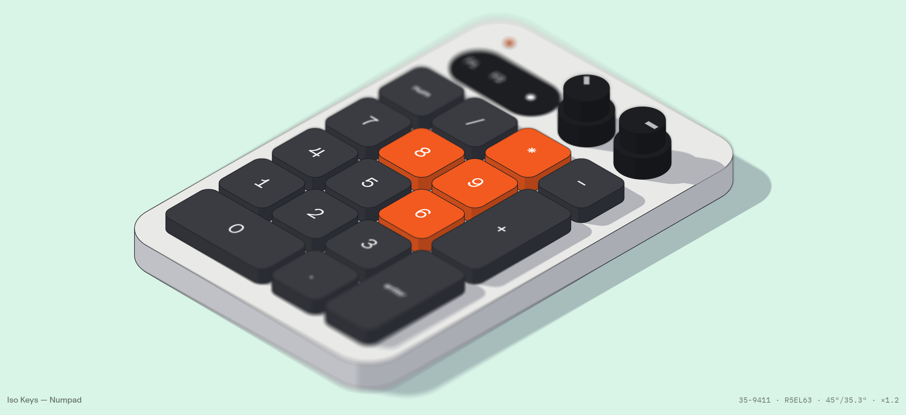

  

# wallforce-light

Light version of the **wallforce** skill: one prompt → one HTML page that generates seed-based Swiss-style wallpapers and downloads them as PNG at the exact screen size.

## Install
- **claude.ai**: Settings › Capabilities › Skills › Upload `wallforce-light.zip`.
- **Claude Code**: unzip into `~/.claude/skills/wallforce-light/`.

## Try
- "Make a quick wallpaper generator about city maps"
- "wallforce light, warm paper colors"

The full **wallforce** adds video export, presentation mode, photo palettes, shaders, style recipes, reference-image analysis, framework installs and automated testing.

## Credits
Created by Victor Vergara — [github.com/victorvergaraux](https://github.com/victorvergaraux).
